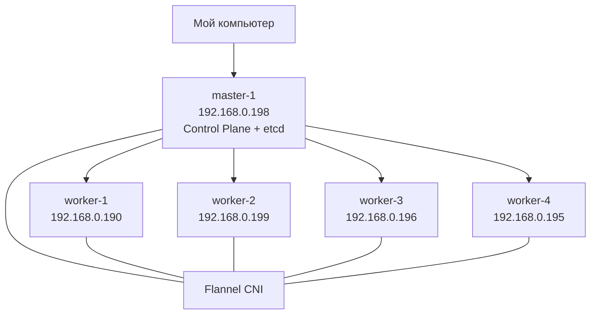
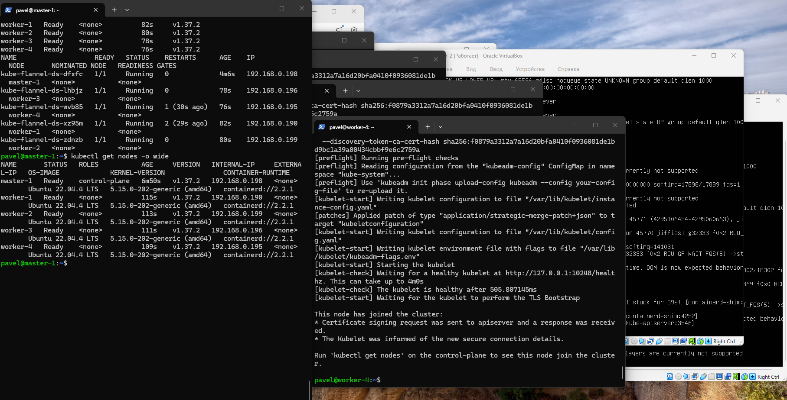
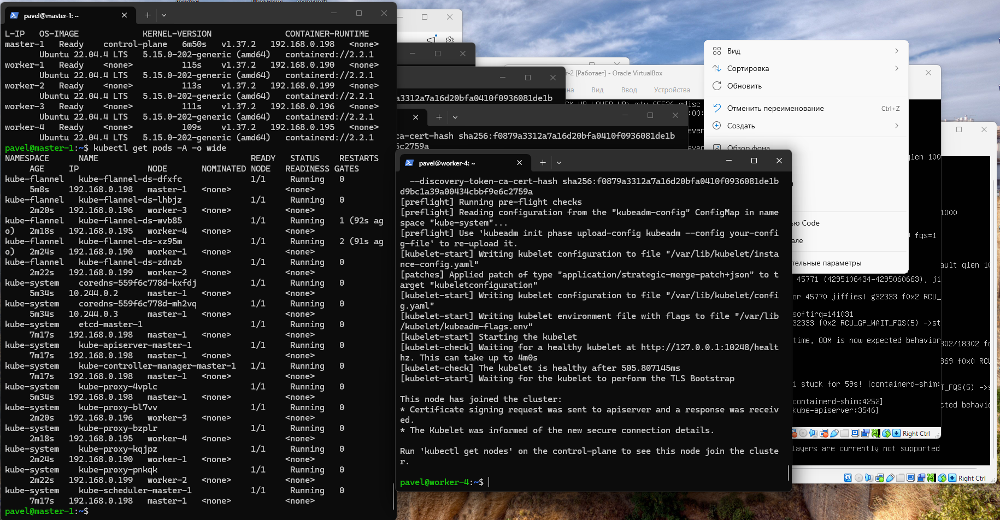
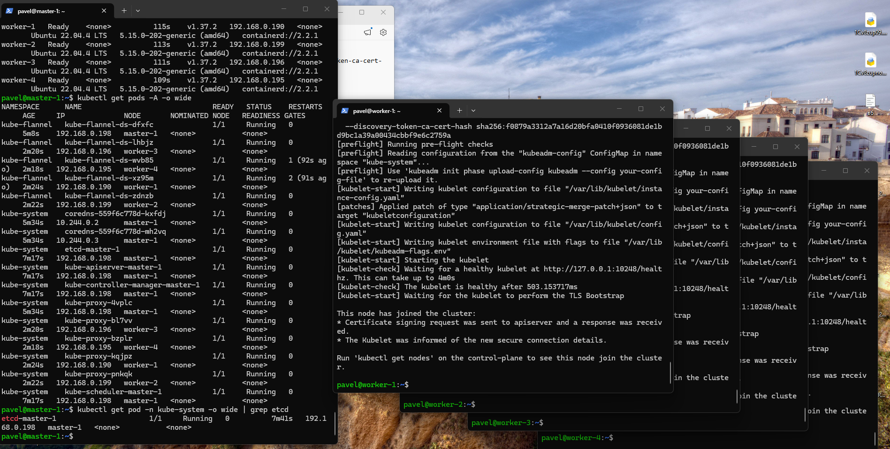

# Домашнее задание: Установка Kubernetes

## Цель

Развернуть Kubernetes-кластер из 5 виртуальных машин:

- 1 Control Plane
- 4 Worker-ноды
- Container Runtime — `containerd`
- `etcd` расположен на Control Plane
- установка Kubernetes выполнена с помощью `kubeadm`

---

## Схема кластера



---

## Виртуальные машины

| Hostname | IP | Роль |
|---|---|---|
| master-1 | 192.168.0.198 | Control Plane + etcd |
| worker-1 | 192.168.0.190 | Worker |
| worker-2 | 192.168.0.199 | Worker |
| worker-3 | 192.168.0.196 | Worker |
| worker-4 | 192.168.0.195 | Worker |

Используемые версии:

- Ubuntu Server 22.04.4 LTS
- Kubernetes v1.37.2
- containerd 2.2.1
- CNI — Flannel

---

# Установка

## 1. Подготовка всех нод

На всех пяти виртуальных машинах отключил swap:

```bash
sudo swapoff -a
sudo sed -i '/ swap / s/^/#/' /etc/fstab
```

Загрузил необходимые модули ядра:

```bash
sudo modprobe overlay
sudo modprobe br_netfilter
```

Создал конфигурацию:

```bash
cat <<EOF | sudo tee /etc/modules-load.d/k8s.conf
overlay
br_netfilter
EOF
```

Настроил параметры сети для Kubernetes:

```bash
cat <<EOF | sudo tee /etc/sysctl.d/k8s.conf
net.bridge.bridge-nf-call-iptables = 1
net.bridge.bridge-nf-call-ip6tables = 1
net.ipv4.ip_forward = 1
EOF
```

Применил настройки:

```bash
sudo sysctl --system
```

---

## 2. Установка containerd

На всех нодах:

```bash
sudo apt update
sudo apt install -y containerd
```

Создал стандартный конфигурационный файл:

```bash
sudo mkdir -p /etc/containerd
containerd config default | sudo tee /etc/containerd/config.toml
```

Для работы Kubernetes настроил использование `systemd` в качестве cgroup driver:

```bash
sudo sed -i 's/SystemdCgroup = false/SystemdCgroup = true/' /etc/containerd/config.toml
```

Перезапустил containerd:

```bash
sudo systemctl restart containerd
sudo systemctl enable containerd
```

Проверка:

```bash
systemctl is-active containerd
```

Результат:

```text
active
```

---

## 3. Установка kubeadm, kubelet и kubectl

Добавил репозиторий Kubernetes:

```bash
sudo apt-get update
sudo apt-get install -y apt-transport-https ca-certificates curl gpg

sudo mkdir -p -m 755 /etc/apt/keyrings

curl -fsSL https://pkgs.k8s.io/core:/stable:/v1.37/deb/Release.key \
  | sudo gpg --dearmor -o /etc/apt/keyrings/kubernetes-apt-keyring.gpg

echo 'deb [signed-by=/etc/apt/keyrings/kubernetes-apt-keyring.gpg] https://pkgs.k8s.io/core:/stable:/v1.37/deb/ /' \
  | sudo tee /etc/apt/sources.list.d/kubernetes.list
```

Установил компоненты:

```bash
sudo apt-get update
sudo apt-get install -y kubelet kubeadm kubectl
```

Запретил автоматическое обновление пакетов:

```bash
sudo apt-mark hold kubelet kubeadm kubectl
```

---

# Настройка Control Plane

На `master-1` выполнил инициализацию Kubernetes:

```bash
sudo kubeadm init \
  --apiserver-advertise-address=192.168.0.198 \
  --pod-network-cidr=10.244.0.0/16 \
  --cri-socket=unix:///run/containerd/containerd.sock
```

В качестве сети Pod используется:

```text
10.244.0.0/16
```

---

## Настройка kubectl

После инициализации кластера настроил доступ к Kubernetes:

```bash
mkdir -p $HOME/.kube

sudo cp /etc/kubernetes/admin.conf $HOME/.kube/config

sudo chown $(id -u):$(id -g) $HOME/.kube/config
```

Проверка:

```bash
kubectl get nodes
```

---

# Установка CNI Flannel

Для взаимодействия Pod между разными Kubernetes-нодами установил Flannel:

```bash
kubectl apply -f https://github.com/flannel-io/flannel/releases/latest/download/kube-flannel.yml
```

Используемый манифест:

https://github.com/flannel-io/flannel/releases/latest/download/kube-flannel.yml

Проверка:

```bash
kubectl get pods -n kube-flannel -o wide
```

В результате Flannel работает на всех пяти нодах.

---

# Подключение Worker-нод

На Control Plane получил команду подключения:

```bash
kubeadm token create --print-join-command
```

На каждой Worker-ноде выполнил полученную команду:

```bash
sudo kubeadm join 192.168.0.198:6443 \
  --token <TOKEN> \
  --discovery-token-ca-cert-hash sha256:<HASH>
```

Таким способом были подключены:

- worker-1
- worker-2
- worker-3
- worker-4

---

# Проверка результата

Для проверки всех нод:

```bash
kubectl get nodes -o wide
```

Результат:

```text
NAME       STATUS   ROLES           VERSION   INTERNAL-IP
master-1   Ready    control-plane   v1.37.2   192.168.0.198
worker-1   Ready    <none>          v1.37.2   192.168.0.190
worker-2   Ready    <none>          v1.37.2   192.168.0.199
worker-3   Ready    <none>          v1.37.2   192.168.0.196
worker-4   Ready    <none>          v1.37.2   192.168.0.195
```

Все пять нод находятся в состоянии `Ready`.

### Скриншот



---

# Проверка системных компонентов Kubernetes

Команда:

```bash
kubectl get pods -A -o wide
```

В кластере работают:

- kube-apiserver
- kube-controller-manager
- kube-scheduler
- kube-proxy
- CoreDNS
- Flannel
- etcd

### Скриншот



---

# Проверка etcd

По заданию `etcd` должен находиться на Control Plane.

Проверка:

```bash
kubectl get pods -n kube-system -o wide | grep etcd
```

Результат показывает:

```text
etcd-master-1   1/1   Running
```

`etcd` работает на ноде:

```text
master-1
```

### Скриншот



---

# Проверка Container Runtime

Команда:

```bash
kubectl get nodes -o wide
```

В колонке `CONTAINER-RUNTIME` отображается:

```text
containerd://2.2.1
```

Таким образом, в качестве CRI используется `containerd`.

---

# Итог

В результате был развернут Kubernetes-кластер из пяти виртуальных машин:

- 1 Control Plane
- 4 Worker-ноды
- все ноды находятся в состоянии `Ready`
- используется Kubernetes v1.37.2
- используется containerd
- для сети используется Flannel
- etcd работает на Control Plane
- управление кластером выполняется через kubectl

Итоговая архитектура:

```text
                master-1
             192.168.0.198
           Control Plane + etcd
                   |
        -------------------------
        |       |       |       |
     worker-1 worker-2 worker-3 worker-4
      .190     .199     .196     .195

          Container Runtime:
               containerd

               CNI:
              Flannel
```